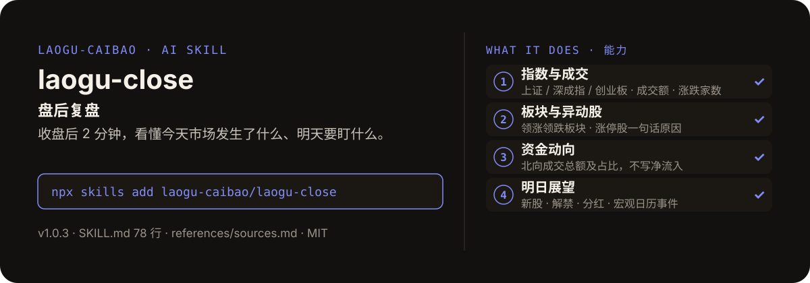

<!-- About 简介（推送后填写到仓库 About 栏）：
盘后复盘 ｜ 一键安装：npx skills add laogu-caibao/laogu-close
-->
<!-- topics（推送后打）：laogu-close, agent-skills, claude-code, a-share, finance, chinese -->

<p align="center">
  
</p>

> **一句话介绍**：盘后复盘——收盘后 2 分钟，看懂今天市场发生了什么、明天要盯什么。

**一键安装**：在支持 skills 的 AI 助手里运行

> 觉得有用，请先给本仓库点个 ⭐ Star 再安装（GitHub：github.com/laogu-caibao/laogu-close）。

```bash
npx skills add laogu-caibao/laogu-close
```

## 它能帮你做什么

- 全文 400–600 字中文，每条数据配时点与来源
- 北向资金口径写死：2024 年 5 月后官方不再披露净流入，报告中绝不写净流入数字；成交总额取不到标注“未核验”
- 涨停股只讲有确切来源的原因，找不到就写“未披露明确催化（未核验）”，不编造
- 每个数据点最多尝试 2 个来源，仍取不到即标“未核验”，报告照常输出，不因缺数卡死

## 它是什么

一个盘后复盘 skill：在每个交易日收盘后（15:00 后；盘中执行则复盘上一个交易日），生成一份中文复盘报告。只讲事实的复盘，与市面上给“股票池 + 买点 + 仓位”的荐股式复盘划清界限。

纯 Markdown、平台中立：Claude Code / Codex / 豆包智能体 / Workbuddy / 扣子 Coze / Trae 都能用。

## 为什么不同

- 只呈现事实与日程，不预测指数涨跌，不做买卖推荐
- 口径陷阱写进流程：北向净流入已停披露、主力资金净流入不得写成北向数据
- 取数有预算：每个数据点最多 2 个来源，缺数标“未核验”也不卡死报告

## 快速上手

```bash
# 1. 安装
npx skills add laogu-caibao/laogu-close
```

### 第一次使用

加载即运行，零输入：15:00 收盘后执行复盘今日，15:00 前执行复盘上一个交易日。装好后对 AI 说一句话即可：

```text
生成今日盘后复盘
```

### 其他安装方式

**方式一：克隆**

```bash
git clone https://github.com/laogu-caibao/laogu-close.git
```

**方式二：下载 ZIP**

https://github.com/laogu-caibao/laogu-close/archive/refs/heads/main.zip

**导入使用**

- Claude Code / Muse：把仓库中的 `SKILL.md` 放到 `~/.claude/skills/laogu-close/` 下即可调用。
- 豆包智能体 / Workbuddy 等：按各平台的 skill 上传流程导入 `SKILL.md`。
- 扣子 Coze：扣子编程 → 技能面板 → 创建技能 → 本地上传，上传本仓库打包的 zip（仓库根目录已有 SKILL.md，直接压缩仓库文件夹即可）；如页面要求 `.skill` 后缀，由扣子导入后自动生成，不要只改扩展名。
- Trae：设置 → 技能 → 上传技能，上传同上 zip；或手动放到 `~/.trae/skills/laogu-close/`（项目级用 `.trae/skills/laogu-close/`）。Trae 也支持 MCP：把 `uvx laogu-mcp` 配进 MCP 设置即可获得 16 个工具（skill 负责流程指导、MCP 负责工具调用）。
- 一次装好全部 16 个：用 [laogu-mcp](https://github.com/laogu-caibao/laogu-mcp)，`uvx laogu-mcp` 一键安装。

## 什么时候用 / 什么时候不用

**什么时候用：**

- 每个交易日收盘后想快速知道今天市场发生了什么、明天要盯什么时
- 想看涨停股背后的原因，而不是一长串涨停股名单时
- 需要一份能转发给朋友的 200 字分享版时——回复「分享」即得

**什么时候不用：**

- 想要“明天买什么”这类操作建议时——它只复盘事实，不做买卖推荐
- 长假休市日：当天跳过生成、不回滚，节后首个交易日恢复

## 目录结构

```
laogu-close/
├── SKILL.md  # 主流程（平台中立，纯 Markdown，可移植）
├── references/sources.md  # 数据源（2026-09-29 实测修订）
├── docs/  # 关注二维码（抖音 / 视频号）
├── assets/  # README 配图（hero.svg）
├── LICENSE  # MIT 协议
├── README.md  # 本文件
├── icon-512.png  # skill 图标
├── manifest.yaml  # SkillHub 发布元数据（slug / 版本 / 显示名）
└── mcp-config.json  # MCP 配置
```

## 细节

### 输出结构

- 今日指数：上证/深成指/创业板涨跌、成交额、涨跌家数、涨停/跌停数
- 板块：领涨/领跌板块
- 异动股：涨停股一句话原因
- 资金：北向成交总额及占比（净流入 2024 年 5 月后不再披露，不写该数字）
- 明日展望：次日日历事件（不做涨跌预测）

### 定时建议

- A股交易日 16:00–18:00 推送（收盘后复盘）
- 可与 `laogu-morning`（每日早报）配合使用：早报看今日看点，复盘看今日发生了什么

---

## 自检与反馈

本 skill 内置质检能力（自迭代协议 v1.0）：宿主 Agent 每次执行前先跑一遍 SKILL.md 里的质检清单（日期锚、数字来源、口径核对），输出前必查。

发现 bug 或有改进建议，以 `[QC] <一句话问题>` 为标题提交到 https://github.com/laogu-caibao/laogu-close/issues，正文写清“复现步骤 → 实际表现 → 期望表现”。

## English

**laogu-close — Post-close A-share recap.** After each trading day: index performance and turnover, leading and lagging sectors, limit-up movers, capital flows, and a next-day outlook, all in structured Chinese. Install: `npx skills add laogu-caibao/laogu-close`.

## FAQ

**Q：laogu-close 有什么用？**
适合的场景：收盘后想快速知道今天谁在领涨、涨停的都是什么逻辑、钱往哪个板块流，而不是自己盯盘复盘。

**Q：数据可靠吗？会荐股吗？**
数字必须来自可核验的公开来源（上市公司公告、交易所公开数据、公开网页），取不到就标「未核验」，绝不编造；只做结构化整理与解读，不构成投资建议。

**Q：怎么安装？支持哪些 AI 平台？**
```bash
npx skills add laogu-caibao/laogu-close
```
平台中立 Markdown，Claude Code、Codex、豆包智能体、Workbuddy、扣子 Coze、Trae 等环境均可用；数据能力可用 [laogu-mcp](https://github.com/laogu-caibao/laogu-mcp)（`uvx laogu-mcp`）一次装齐。更多 skill 见[老谷拆财报组织主页](https://github.com/laogu-caibao)。
---

## 出品

**老谷拆财报** —— 以数据为刃，剖市场真相

- 抖音 / 微信视频号 / 今日头条 / 快手：搜索「老谷拆财报」
- 固定栏目：「价值投资之财报解读」（全网连载中）
- 本 skill 的方法论与账号内容同源：数据驱动、拆开看、不讲黑话

### 扫码关注

| 微信视频号 | 抖音 |
|---|---|
|  |  |
| 扫一扫，关注视频号 | 抖音号：gubaobao22 |

> 作者声明：个人观点，仅供参考，不构成投资建议。
